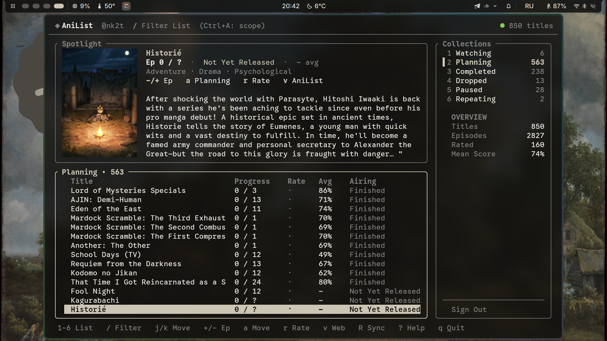
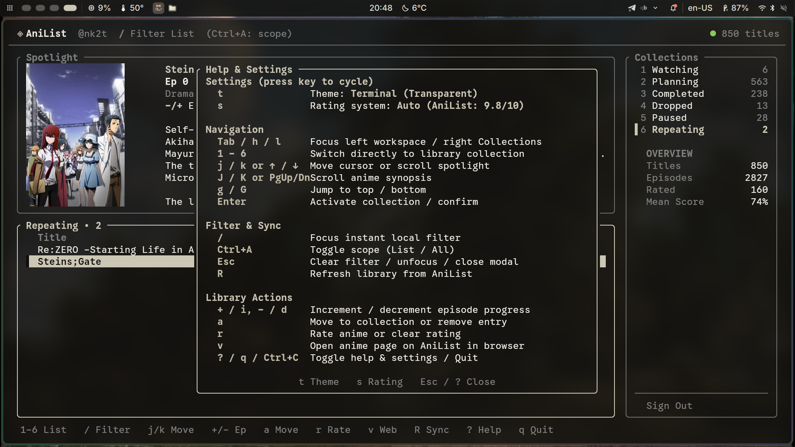
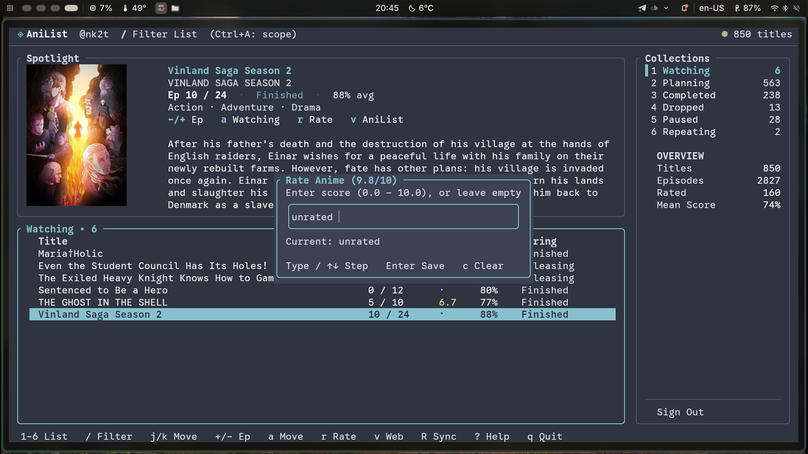
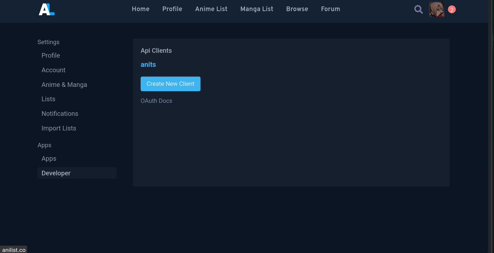
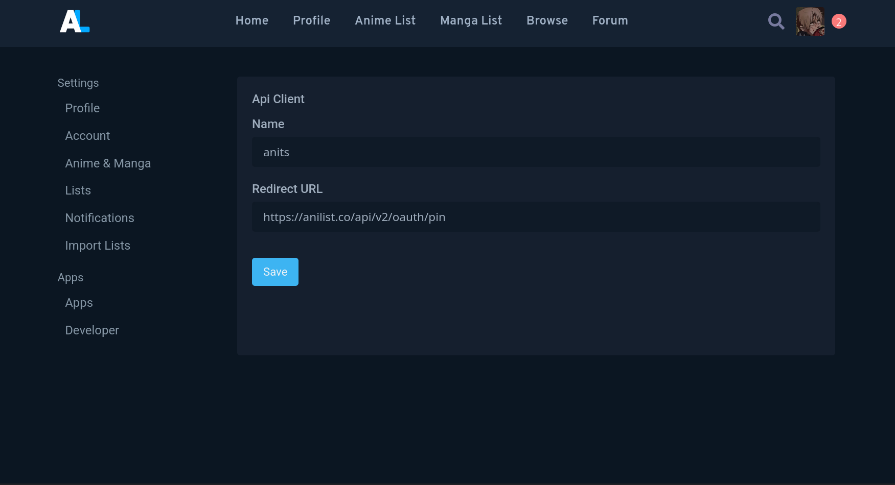
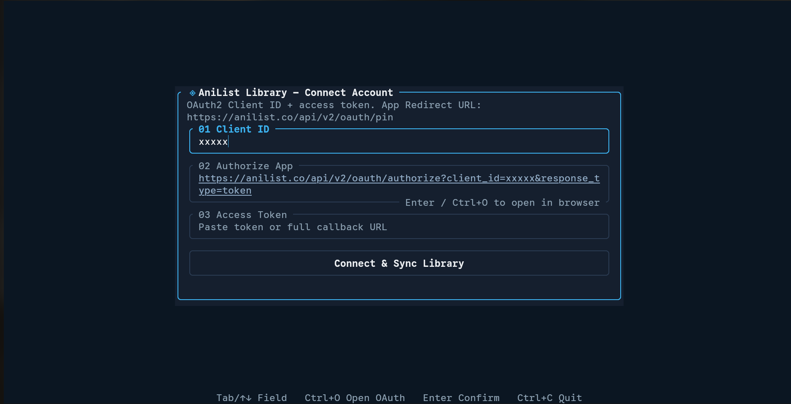

# anits

Fast terminal user interface for managing your personal [AniList](https://anilist.co) anime library, written in Rust with `ratatui` and `ratatui-image`.

## Preview





## Features

- **Instant library navigation & filtering** across `Watching`, `Planning`, `Completed`, `Dropped`, `Paused`, and `Repeating` (`0ms` in-memory search via `/`)
- **Terminal cover art** via `ratatui-image` (requires terminal with image support, like kitty, ghostty, wezterm) with off-thread decoding and disk + LRU caching
- **Optimistic mutations** for episode progress (`+`/`-`), collection moves (`a`), and ratings (`r`) with automatic rollback on network errors
- **Account-aware rating system** following your AniList `scoreFormat` (`9.8/10`, `100`, `10`, `5★`, `3-point smiley`)
- **Colorschemes** including the default AniList dark palette, transparent terminal theme, Catppuccin Mocha, Tokyo Night, Nord, Gruvbox, and Dracula
- **Instant startup** via cached snapshots (`stale-while-revalidate`) and persistent HTTP/2 connection pooling

## Installation

it's in crates.io, so you can just

```bash
cargo install anits
```

### Build from source

```bash
git clone https://github.com/arprge/anits.git
cd anits
cargo install --path . --locked
```

## AniList Setup

1. Open [AniList Developer Settings](https://anilist.co/settings/developer) and click `Create New Client`

   
   
2. Set the `Redirect URL` to `https://anilist.co/api/v2/oauth/pin`

   

3. Launch `anits`, enter your **Client ID**, press `Ctrl+O` to open the OAuth link in your browser, and paste the token

   

> [!NOTE]
> If AniList reports `unsupported_grant_type`, the client's Redirect URL is
> pointing at a callback/token server. Change it to the pin URL above, save,
> and open the authorization link again. `anits` uses the implicit grant and
> never exchanges an authorization code.

## Keybindings

| Key                          | Action                                                              |
| ---------------------------- | ------------------------------------------------------------------- |
| `1` – `6`                    | Switch directly to `Watching`..`Repeating`                          |
| `Tab` / `h` / `l`            | Switch focus between left workspace and right `Collections` rail    |
| `j` / `k` or `↑` / `↓`       | Move selection or scroll                                            |
| `J` / `K` or `PgDn` / `PgUp` | Scroll anime synopsis                                               |
| `g` / `G`                    | Jump to top / bottom                                                |
| `/`                          | Filter library (`Ctrl+A` toggles `Current List` / `All Lists`)      |
| `+` / `i`, `-` / `d`         | Increment / decrement watched episodes (debounced)                  |
| `a`                          | Move entry to another collection or remove from library             |
| `r`                          | Rate anime or clear rating                                          |
| `v`                          | Open anime page on AniList in browser                               |
| `R`                          | Refresh library from AniList                                        |
| `?`                          | Open **Help & Settings** (`t` cycle theme, `s` cycle rating system) |
| `q` / `Ctrl+C`               | Quit                                                                |

## Configuration

Settings and themes are persisted automatically when cycled in `?`, or can be edited in `~/.config/anits/config.toml`:

```toml
[ui]
# Curated themes: "anilist", "terminal", "catppuccin-mocha", "tokyo-night", "nord", "gruvbox", "dracula"
theme = "anilist"
# Optional background override: "#0b1622" or "transparent"
# background = "transparent"
# Rating format: "auto", "point-10-decimal", "point-100", "point-10", "point-5", "point-3"
score_format = "auto"
```

- **Auth session**: `~/.config/anits/auth.json` (`0o600` on Unix)
- **Cache**: `~/.cache/anits/`

## License

[MIT](LICENSE)
